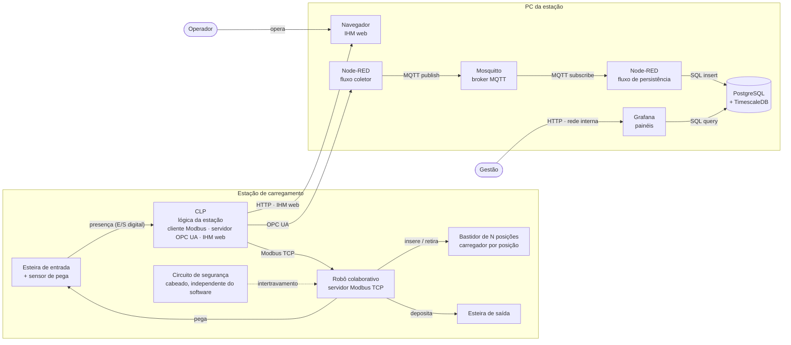
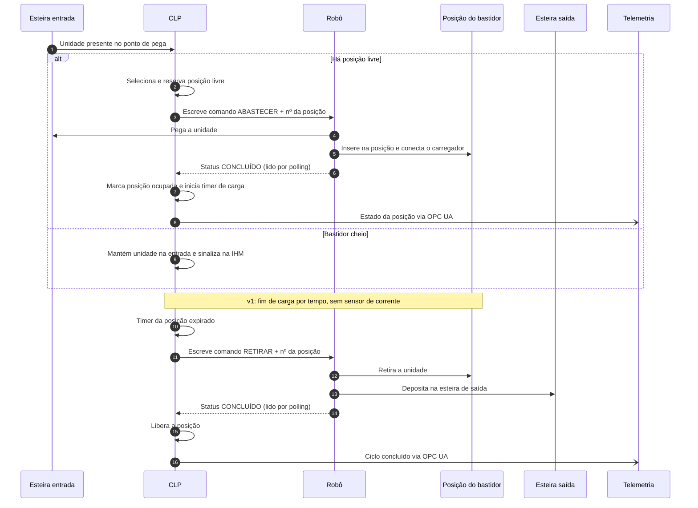
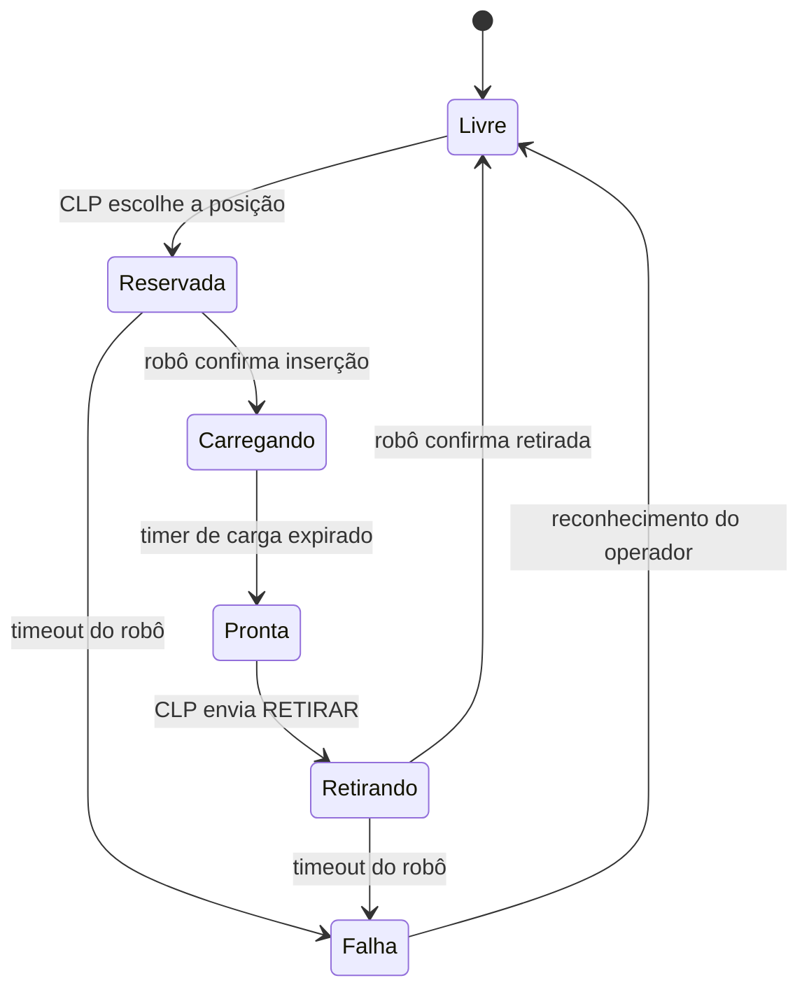

# Estação Automatizada de Carregamento de Dispositivos — Documentação de Arquitetura

Repositório de *discovery* de documentação no formato **diagrams as code**. O objetivo é concentrar a descrição do sistema e seus diagramas em Mermaid, versionados junto com o texto, para que sirvam de base de revisão humana e de contexto para agentes de desenvolvimento.

> Baseado em um projeto real. Produto, fabricantes, modelos de equipamento e parâmetros internos foram omitidos ou generalizados.

---

## 1. Descrição do sistema

### 1.1 Escopo

Estação que recebe dispositivos eletrônicos com níveis de carga de bateria diferentes, armazena cada unidade em um bastidor com **N posições**, carrega até o fim e devolve a unidade à linha. Um robô colaborativo faz o abastecimento e a retirada; um CLP coordena a estação. Uma camada de IoT coleta telemetria para histórico e painéis de gestão.

A estação trabalha **sempre com um único tipo de dispositivo por vez**.

### 1.2 Nível da visão

- **Estrutural:** visão de *containers*, inspirada no nível 2 do C4: blocos executáveis ou físicos da estação e como se comunicam.
- **Comportamental:** sequência do ciclo completo de uma unidade (jornada crítica) e máquina de estados de uma posição do bastidor.

Não cobre a lógica interna dos programas do CLP e do robô nem o projeto elétrico.

### 1.3 Limites e responsabilidades

| Elemento | Responsabilidade | Fora da responsabilidade |
|---|---|---|
| CLP | Lógica da estação: detectar unidade na entrada, escolher posição livre, comandar o robô, controlar o tempo de carga de cada posição, expor IHM web e telemetria (OPC UA) | Trajetórias do robô; segurança de máquina |
| Robô colaborativo | Executar pega, inserção na posição, retirada e depósito na esteira de saída; reportar status | Decidir qual posição usar ou quando retirar |
| Bastidor de N posições | Alojar e carregar as unidades (um carregador por posição) | Detectar fim de carga (na v1) |
| Circuito de segurança | Parada de emergência e proteção do operador, cabeado e independente | Não depende de nenhum software desta documentação |
| PC da estação | Exibir a IHM e hospedar a pilha de IoT | Controle da máquina |
| Pilha de IoT | Coletar, transportar, armazenar e exibir telemetria | Enviar comandos à estação (somente leitura) |

### 1.4 Integrações

| Origem → Destino | Protocolo | Conteúdo |
|---|---|---|
| CLP → Robô | Modbus TCP (robô como **servidor**) | Comandos (abastecer/retirar, nº da posição) e leitura de status |
| Sensor de entrada → CLP | E/S digital | Presença de unidade no ponto de pega |
| CLP → Navegador do PC | HTTP | IHM web servida pelo próprio CLP |
| CLP → Node-RED | OPC UA | Estado das posições, ciclos, alarmes |
| Node-RED → Mosquitto | MQTT (com autenticação) | Telemetria publicada em tópicos |
| Node-RED → PostgreSQL/TimescaleDB | SQL | Histórico de telemetria |
| Grafana → PostgreSQL/TimescaleDB | SQL | Consultas para painéis |
| Gestão → Grafana | HTTP (rede interna) | Visualização dos painéis |

### 1.5 Restrições

- O robô não oferece protocolos industriais de alto nível nesta versão: a integração com o CLP é **somente Modbus TCP**.
- **v1 sem sensor de carga:** o fim da carga é definido por **tempo** controlado pelo CLP, por posição.
- Um único tipo de dispositivo por vez na estação.
- IHM da estação = interface web do próprio CLP, exibida no PC (sem painel IHM dedicado).
- Toda a pilha de IoT roda **localmente** no PC da estação (sem nuvem).
- O coletor começa em **Node-RED** e depois será reescrito em **Python**.
- A camada de IoT é estritamente de leitura: nenhum comando à máquina sai dela.
- Equipe muito pequena: a solução precisa ser mantida por uma pessoa.

### 1.6 Lacunas e questões em aberto

- **Mapa de registros Modbus:** endereços, significado e codificação de comando/status ainda não documentados aqui.
- **Medição de corrente por posição:** prevista como evolução para detectar o fim de carga real; não faz parte da v1. Falta definir como os sensores chegam ao CLP.
- **Tempo de carga:** como é definido e onde é configurado (fixo, por receita, via IHM).
- **Prioridade entre abastecer e retirar** quando os dois estão pendentes ao mesmo tempo.
- **Tratamento de falhas:** timeout do robô, unidade não pega, posição com falha, bastidor cheio.
- **Esquema de tópicos MQTT, tags OPC UA e tabelas do banco**, além da política de retenção.
- **Acesso da gestão ao Grafana:** autenticação e liberação na rede (depende da TI).
- **Requisitos não funcionais:** tempo de ciclo alvo, disponibilidade esperada.

---

## 2. Diagrama estrutural — visão de containers

Fonte: [`diagrams/containers.mmd`](diagrams/containers.mmd)



---

## 3. Diagrama comportamental — ciclo de uma unidade

Fonte: [`diagrams/ciclo-unidade.mmd`](diagrams/ciclo-unidade.mmd)

O robô é servidor Modbus: o CLP **escreve** comandos nos registros do robô e **lê por polling** o registro de status.



### 3.1 Estados de uma posição do bastidor

Fonte: [`diagrams/estados-posicao.mmd`](diagrams/estados-posicao.mmd)



> Os estados de **Falha** são uma proposta para discussão; o tratamento de falhas ainda está em aberto (ver 1.6).

---

## 4. Decisões e ajustes sobre o que a GenAI gerou

Os diagramas foram gerados com GenAI a partir da descrição da seção 1 e revisados manualmente.

| O que o modelo gerou | Ajuste feito | Motivo |
|---|---|---|
| Integração robô–CLP via EtherNet/IP | Trocado para Modbus TCP | O robô não oferece esse protocolo nesta versão |
| Robô como cliente Modbus, CLP como servidor | Invertido: robô é servidor, CLP escreve e faz polling | Configuração validada em bancada |
| Detecção de fim de carga por sensor | Substituída por timer no CLP | Sensores de corrente ficaram para versão futura |
| Banco de dados e Grafana em nuvem | Movidos para o PC da estação | Restrição de operar localmente |
| Pilha de IoT enviando comandos ao CLP | Removido; fluxo apenas de leitura | Telemetria não pode interferir no controle |
| Circuito de segurança passando pelo CLP | Representado como independente e cabeado | Segurança de máquina não depende de software |
| Diagrama C4 com sintaxe `C4Container` | Reescrito como `flowchart` | Renderização mais estável no GitHub |
| Ausência de cenário de bastidor cheio | Adicionado bloco `alt` na sequência | Caso real de operação |

---

## 5. O que falta para um agente implementar sem inventar decisões

- Mapa completo de registros Modbus (endereço, tipo, valores possíveis, quem escreve).
- Regras de prioridade e de escolha de posição (sequencial, menor índice, rodízio).
- Política de tempos: tempo de carga, timeouts do robô e do polling.
- Tratamento de cada falha e o que o operador vê e faz na IHM.
- Esquema de tags OPC UA, tópicos MQTT (nomes, payload JSON, QoS) e tabelas do banco.
- Requisitos não funcionais com números (tempo de ciclo, retenção, disponibilidade).
- ADRs das decisões já tomadas (Modbus, IHM web do CLP, IoT local, Node-RED → Python).
- Critérios de aceite testáveis por cenário.
- Fronteira explícita do que um agente **não pode** alterar (programas de segurança, configuração do robô).

---

## 6. Estrutura do repositório

```
.
├── README.md
└── diagrams/
    ├── containers.mmd
    ├── ciclo-unidade.mmd
    └── estados-posicao.mmd
```

Os arquivos `.mmd` são a fonte dos diagramas; o GitHub renderiza os blocos Mermaid diretamente no README.
